<picture>
  <source media="(prefers-color-scheme: dark)" srcset="assets/hero-dark.svg">
  
</picture>

Backend-leaning full-stack engineer at [Awiros](https://www.awiros.com), which runs video AI for airports and smart cities. I build the Go and Node.js services, Kafka and ClickHouse pipelines and vector search underneath, and the React apps operators use on top, and I ship them to on-prem sites. Promoted to SDE II in June 2026; company-wide Best Performer two cycles running.

### Production work

- **Seek**, natural-language person search across video alerts, used at 33 Indian airports. I designed and built it in Go on Milvus, gRPC and Kafka. It takes in 650K alerts and 1.3M embeddings a day, made every alert searchable (up from 58%) and cut median search time from 51 s to 4.7 s.
- **UVIP**, Awiros's video-intelligence platform. I led the ground-up rebuild in React 19 and TypeScript and owned its product and UX: 31 modules on one live client cache, behind 300+ typed RTK Query endpoints.
- **Delhi IGI Airport.** The backend behind the airport's operations dashboards is mine, including e-challan filing with Delhi Traffic Police (9,189 challans filed) and per-belt trolley planning from live AODB arrivals.
- **An event pipeline on ClickHouse** that I architected now handles 20M+ events a day. At Bangalore Safe City (3,500+ cameras) it cut downtime 99% and storage from 5 TB to 450 GB.

This work lives in private company repositories. More detail on <a href="https://linkedin.com/in/aryanteng">LinkedIn</a>.

### What I build with

<table>
  <tr>
    <th align="left">Backend and data</th>
    <th align="left">Frontend and mobile</th>
    <th align="left">Infra and delivery</th>
  </tr>
  <tr valign="top">
    <td>
      
      
      
      
      
      
      
      
      
    </td>
    <td>
      
      
      
      
      
    </td>
    <td>
      
      
      
      
    </td>
  </tr>
</table>

### Before Awiros

- [**cse.iiitd.ac.in**](https://cse.iiitd.ac.in), the official IIIT-Delhi CSE department website. I built it in Next.js with five other students; content lives in Google Sheets so department staff update the site without touching code.
- [**Sahaayak**](https://github.com/aryanteng/Sahaayak): sequence-alignment and ORF tools for biology students, from my Computer Science and Biosciences degree.

My work commits live in my employer's private repositories. A private repo here replays one timestamp per real commit, with no code or messages, so the graph matches my actual activity.
